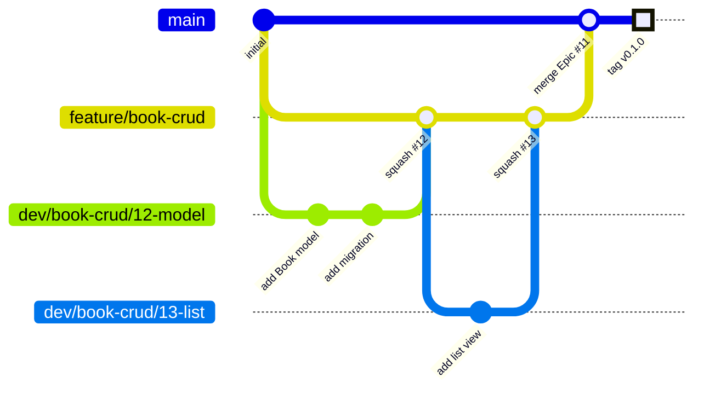

# fcrud-llm プロジェクト計画書 01

> 「読んだ本と感想」を CRUD できるシンプルな Web アプリを題材に、**issue・PR・ブランチ戦略を含む開発工程の見本**を示すリポジトリ。

---

## 0. ドキュメント規約

| 種類 | 配置 | 規則 |
| --- | --- | --- |
| トピック別ドキュメント | `docs/<トピック名>/NN.md` | 同じトピックの続編・改訂は `02.md`, `03.md` … と連番で追加する。既存ファイルは原則書き換えず、新しい番号で差分を書く |
| 作業履歴 | `docs/histories/NN.md` | **作業のたびに1ファイル**、連番で作成する。依頼内容・調査・決定事項・変更ファイル・次の作業を記録する |

- トピック名は英小文字のケバブケース（例: `project-plan`, `branch-strategy`, `gcp-deploy`）。
- ドキュメント・issue・PR は日本語、**コミットメッセージは英語**。

---

## 1. 目的と背景

### 1.1 背景

- 開発者（リポジトリのオーナー）は実務経験がなく、病気療養をしながらプログラミングを学んできた。就職のためにポートフォリオを作っている。
- ポートフォリオ1作目の **flaskboard** は、開発工程が乱雑になってしまった。
- そこで **py-ci-tpl** で開発手法を実践的に学んでいるが、見本がなくて苦戦している。

### 1.2 このリポジトリの目的

1. **開発工程の見本**になること。コードだけでなく、次のものを後から読み返せる形で残す。
   - issue の立て方、粒度、クローズのしかた
   - ブランチの切り方と命名
   - PR の書き方、レビュー、マージ方法
   - コミットの粒度とメッセージ
   - CI/CD の組み立て方
2. flaskboard を作り直すとき（2作目以降も含む）に、そのまま真似できる手順を示すこと。

### 1.3 役割分担

| 担当 | 内容 |
| --- | --- |
| Claude | 見本となるコード・issue・PR・ブランチ・ドキュメントを作る。判断の理由を `docs/histories/` に残す |
| オーナー | issue や PR、履歴を読んで工程を学ぶ。方針の決定と承認を行う |

---

## 2. flaskboard・py-ci-tpl から見えた課題と対策

### 2.1 調査結果の要約

**flaskboard**

- main は `initial commit` の1コミットだけで、作業がまったくマージされていない。
- ブランチが13本ある（`dev/` `feat/` `fix/` `debug/` `poc/` `refactor/`）。役割の違うプレフィックスが混在している。
- PR #6 と #7 は main ではなく `dev/docker-and-docker` などの作業ブランチにマージされている。
- issue #1〜#10 はすべて open のまま。PR とのリンクやラベルもない。
- #4: push 済みのブランチの履歴を書き換えたため、issue に書いた commit hash が無効になった。
- #3 / #5: pre-commit の mypy では検出されないエラーが、`uv run mypy` や CI では検出された。
- #9: `.env.example` の書き方が統一されていない。
- 良い点: Justfile（`prepare-hooks` / `modify` / `verify`）、pyproject.toml での ruff・mypy・pytest の設定、キャッシュを `.ci_cache/` に集めていること。

**py-ci-tpl**

- `main ← feature/ruff ← dev/ruff/installation` の3段構成で、PR #1 を経由してマージしている。
- コミットは Conventional Commits の形式になっている（`chore(deps): add Ruff constrained to 0.17.* ...`）。
- ツールのバージョンを固定している: Python `==3.15.*`、uv `0.13.*`、uv_build `0.13.*`、Ruff `0.17.*`。
- issue #2 は「設定の仕組みを理解してから値を決める」という調査型の issue。
- README に「pre-commit はミラーではなくローカルフックを使い、ローカルと CI のチェックを一致させる」と書かれている。

### 2.2 課題 → fcrud-llm でのルール

| # | 課題（flaskboard） | 原因 | fcrud-llm でのルール |
| --- | --- | --- | --- |
| 1 | main に何もマージされていない | 「完成したら main へ」という区切りがない | 機能（Epic）ごとに `feature/*` を作り、完了したら**必ず** main へ PR を出す。マイルストーンごとにタグを打つ |
| 2 | ブランチの種類が多く、役割が曖昧 | 命名規則がない | 使ってよいプレフィックスは `feature/` `dev/` `hotfix/` `spike/` の4種類だけ（§6） |
| 3 | PR の向き先がバラバラ | 親子関係が決まっていない | `dev/*` → `feature/*` → `main` の向きだけを許可する |
| 4 | issue が open のまま | クローズの条件・タイミングが決まっていない | issue に完了条件を書く。PR がマージされたらクローズする（§7.5） |
| 5 | push 後の履歴書き換えで hash が無効になった | 共有ブランチで rebase / force-push した | push 済みの `main` / `feature/*` では rebase と force-push を禁止する。試行錯誤は `spike/*` で行う |
| 6 | pre-commit と CI の結果が違う | `mirrors-mypy` が依存（flask など）のない隔離環境で動き、型が `Any` 扱いになる | pre-commit はすべてローカルフック（`uv run ...`）にして、CI と同じ仮想環境で実行する |
| 7 | 検証用ブランチ（`debug/` `poc/`）が残り続ける | 検証と実装が混ざっている | 検証は Investigation issue と `spike/*` で行い、spike はマージしない。結論は issue に書く |
| 8 | `.env.example` の表記ゆれ | 書式ルールがない | §12 の書式ルールに従う |

---

## 3. プロダクト要件

### 3.1 概要

読んだ本と、その感想を登録・一覧・編集・削除できる Web アプリ。

### 3.2 データモデル

**Book（v0.1）**

| カラム | 型 | 制約 | 説明 |
| --- | --- | --- | --- |
| id | integer | PK | |
| title | varchar(200) | NOT NULL | 書名 |
| author | varchar(100) | NOT NULL | 著者 |
| read_on | date | NULL 可 | 読了日 |
| rating | smallint | 1〜5, NULL 可 | 評価 |
| impression | text | NOT NULL | 感想 |
| created_at | timestamptz | NOT NULL, default now | |
| updated_at | timestamptz | NOT NULL, 更新時に自動更新 | |

**User（v0.2）**

| カラム | 型 | 制約 |
| --- | --- | --- |
| id | integer | PK |
| email | varchar(255) | NOT NULL, UNIQUE |
| password_hash | varchar(255) | NOT NULL |
| created_at | timestamptz | NOT NULL |

v0.2 では Book に `user_id`（FK → users.id, NOT NULL）を追加する。

### 3.3 画面とルーティング（v0.1）

| メソッド | パス | 画面・処理 |
| --- | --- | --- |
| GET | `/` | `/books` へリダイレクト |
| GET | `/books` | 一覧（新しい順） |
| GET | `/books/new` | 新規作成フォーム |
| POST | `/books` | 作成 → 詳細へリダイレクト |
| GET | `/books/<id>` | 詳細 |
| GET | `/books/<id>/edit` | 編集フォーム |
| POST | `/books/<id>/edit` | 更新 → 詳細へリダイレクト |
| GET | `/books/<id>/delete` | 削除確認 |
| POST | `/books/<id>/delete` | 削除 → 一覧へリダイレクト |
| GET | `/healthz` | ヘルスチェック（Cloud Run 用。DB 接続も確認する） |

- HTML フォームは GET / POST しか送れないため、更新と削除は POST で受ける。
- 存在しない id には 404 ページを返す。
- 作成・更新・削除のあとにフラッシュメッセージを表示する。

### 3.4 機能要件

- 入力検証: 必須項目、文字数、rating は 1〜5。エラーはフォームの各項目の下に表示する。
- CSRF 対策: Flask-WTF の CSRF トークンを使う。

### 3.5 v0.2 で追加する機能

- ユーザー登録、ログイン、ログアウト（Flask-Login）。
- 本は登録したユーザー本人だけが閲覧・編集・削除できる。他人の本の URL には 404 を返す。

### 3.6 非機能要件

- フロントエンドは Node.js を使わない（Jinja2 + Bootstrap を CDN から読み込む）。
- 本番は HTTPS（Cloud Run の標準機能）。
- 秘密情報（DB パスワード、`SECRET_KEY`）をイメージやリポジトリに含めない。

---

## 4. 技術スタック

| 分類 | 採用技術 | バージョン方針 | 役割 |
| --- | --- | --- | --- |
| 言語 | Python | `==3.15.*` | py-ci-tpl に合わせる |
| パッケージ管理 | uv | `==0.13.*` | 依存管理、仮想環境、スクリプト実行 |
| ビルド | uv_build | `==0.13.*` | パッケージのビルドバックエンド |
| Web フレームワーク | Flask | 導入時の最新マイナーで固定 | ルーティング、app factory |
| テンプレート | Jinja2 | Flask に付属 | HTML 生成 |
| CSS | Bootstrap 5 | CDN（jsDelivr）でバージョンを固定 | レイアウト。Node 不要 |
| ORM | Flask-SQLAlchemy（SQLAlchemy 2.x） | 導入時に固定 | モデル定義、クエリ |
| マイグレーション | Flask-Migrate（Alembic） | 導入時に固定 | スキーマ変更の履歴管理 |
| DB ドライバ | psycopg 3 | 導入時に固定 | PostgreSQL 接続 |
| フォーム | Flask-WTF | 導入時に固定 | 入力検証、CSRF |
| 認証（v0.2） | Flask-Login | 導入時に固定 | セッション管理 |
| WSGI サーバ | gunicorn | 導入時に固定 | 本番実行 |
| DB | PostgreSQL | 18 系 | ローカルは Docker、本番は Cloud SQL |
| コンテナ | Docker / Docker Compose | | ローカル開発と本番イメージ |
| Lint / Format | Ruff | `==0.17.*` | py-ci-tpl に合わせる |
| 型チェック | mypy | 導入時に固定 | |
| テスト | pytest / pytest-cov | 導入時に固定 | |
| Git フック | pre-commit | 導入時に固定 | ローカルフックのみ使う |
| タスクランナー | just | | コマンドの共通化 |
| CI/CD | GitHub Actions | | |
| デプロイ | GCP（Cloud Run, Cloud SQL, Artifact Registry, Secret Manager） | | §14 |

- バージョンは「メジャー・マイナーを pyproject.toml で制限し、パッチは `uv.lock` で固定する」方針にする（py-ci-tpl と同じ）。
- 依存を1つ追加するごとに PR を分け、PR にバージョンを選んだ理由を書く。

---

## 5. ディレクトリ構成（完成時の想定）

```text
fcrud-llm/
├── .github/
│   ├── ISSUE_TEMPLATE/
│   │   ├── epic.md
│   │   ├── task.md
│   │   ├── bug.md
│   │   └── investigation.md
│   ├── pull_request_template.md
│   └── workflows/
│       ├── ci.yml
│       └── deploy.yml
├── docs/
│   ├── project-plan/01.md
│   └── histories/01.md, 02.md, ...
├── migrations/                  # Flask-Migrate が生成
├── src/fcrud_llm/
│   ├── __init__.py              # create_app()（app factory）
│   ├── config.py                # Config / TestConfig
│   ├── extensions.py            # db, migrate, csrf のインスタンス
│   ├── models.py
│   ├── books/
│   │   ├── __init__.py          # Blueprint
│   │   ├── routes.py
│   │   └── forms.py
│   ├── auth/                    # v0.2
│   ├── health.py
│   └── templates/
│       ├── base.html
│       ├── errors/404.html
│       └── books/{index,detail,form,delete}.html
├── tests/
│   ├── conftest.py
│   ├── test_health.py
│   └── books/test_routes.py
├── .env.example
├── .gitignore
├── .pre-commit-config.yaml
├── .python-version
├── compose.yaml
├── Dockerfile
├── Justfile
├── pyproject.toml
├── uv.lock
└── README.md
```

---

## 6. ブランチ戦略

### 6.1 3段構成

py-ci-tpl で練習している3段構成を引き継ぐ。

| ブランチ | 役割 | 切る元 | マージ先 | 寿命 |
| --- | --- | --- | --- | --- |
| `main` | 常にデプロイ可能な状態。main へのマージ＝本番反映 | — | — | 永続 |
| `feature/<機能>` | 1つの機能（Epic issue）の統合ブランチ | `main` | `main` | 機能の完成まで |
| `dev/<機能>/<issue番号>-<作業>` | 1つの Task issue の作業ブランチ | `feature/<機能>` | `feature/<機能>` | issue の完了まで |
| `hotfix/<issue番号>-<内容>` | 本番障害の緊急修正（例外） | `main` | `main` | 修正の完了まで |
| `spike/<issue番号>-<内容>` | 技術検証・お試し（例外） | どこからでも | **マージしない** | 検証の完了まで |

### 6.2 命名例

```text
feature/book-crud
dev/book-crud/14-create-form
dev/book-crud/15-edit-and-delete
hotfix/31-healthz-timeout
spike/22-cloud-sql-connector
```

- 英小文字とハイフンだけを使う。
- `dev/*` と `hotfix/*` と `spike/*` には必ず issue 番号を入れる。ブランチ名から issue を辿れるようにするため。

### 6.3 流れ（図）



### 6.4 マージ方法

| PR の向き | マージ方法 | 理由 |
| --- | --- | --- |
| `dev/*` → `feature/*` | **Squash merge** | 1 issue = feature 上の1コミットにまとめ、試行錯誤のコミットを統合ブランチに持ち込まない |
| `feature/*` → `main` | **Merge commit** | main 上で「どこからどこまでが1機能か」を残す |
| `hotfix/*` → `main` | Squash merge | 1修正 = 1コミット |

### 6.5 ブランチは削除しない

- **このリポジトリでは、マージ済みのブランチも含めてすべて残す。** 手本として、どのブランチで何をしたかを後から見返せるようにするため。
- その代わり、**マージ済みのブランチには追加でコミットしない**。続きの作業は新しい issue と新しいブランチで行う。
- マージ済みかどうかは、そのブランチの PR の状態（Merged）で判断する。
- 補足: 一般的な実務では、マージしたブランチは削除することが多い（GitHub の「Automatically delete head branches」設定）。この点は面接などで聞かれたときに説明できるようにしておく。

### 6.6 同期と履歴の扱い

- `main` が進んだら（hotfix など）、`feature/*` に `main` を**マージ**して取り込む（rebase はしない）。
- `feature/*` が進んだら、作業中の `dev/*` に `feature/*` をマージして取り込む。
- **push 済みの `main` と `feature/*` では rebase・force-push・amend を禁止する。** 対策 #5。
- 自分だけが使っている `dev/*` で、PR を出す前にコミットを整理するのは構わない（`git rebase -i` など）。ただし PR を出したあとは履歴を書き換えない。

### 6.7 ブランチ保護（GitHub の設定）

| 対象 | 設定 |
| --- | --- |
| `main` | PR 必須、CI 合格必須、force-push 禁止、削除禁止 |
| `feature/*` | PR 必須、CI 合格必須、force-push 禁止 |

---

## 7. Issue 運用

### 7.1 Issue の種類（テンプレート）

| 種類 | 用途 | ラベル | 例 |
| --- | --- | --- | --- |
| Epic | 1つの機能のまとめ。`feature/*` と1対1で対応する | `type:epic` | 「本の CRUD 機能」 |
| Task | 1つの作業。`dev/*` と1対1で対応する | `type:feature` / `type:chore` / `type:docs` / `type:test` / `type:ci` | 「本の作成フォームを実装する」 |
| Bug | 不具合 | `type:bug` | 「編集後に updated_at が更新されない」 |
| Investigation | 調査・検証。`spike/*` を使う | `type:investigation` | 「Cloud SQL への接続方式を比較する」 |

### 7.2 ラベルとマイルストーン

- ラベルは `type:*` の1軸だけで始める（増やしすぎると運用されなくなるため）。
- マイルストーンは `v0.0 基盤`、`v0.1 CRUD + デプロイ`、`v0.2 認証`。

### 7.3 Issue 本文の型

```markdown
## 背景
なぜこの作業が必要か。

## 目的
この issue で達成すること（1〜2行）。

## 完了条件
- [ ] 〜できる
- [ ] テストが追加されている

## 補足
参考リンク、関連 issue（#12 など）。
```

### 7.4 Epic と sub-issue

- Epic issue に Task issue を **sub-issue** として紐付ける。Epic の進捗が一目で分かるようにするため。
- Epic の本文に、対応する `feature/*` ブランチ名を書く。

### 7.5 Issue のクローズ（重要）

- GitHub の `Closes #12` による自動クローズは、**デフォルトブランチ（main）へのマージでしか動かない**。
- 3段構成では `dev/*` → `feature/*` の PR がマージされても issue は閉じない。そこで次のように運用する。

| PR | 本文の書き方 | クローズ |
| --- | --- | --- |
| `dev/*` → `feature/*` | `Refs #12` | マージ直後に Task issue を**手動でクローズ**する（理由: completed） |
| `feature/*` → `main` | `Closes #11`（Epic） | main へのマージで Epic が自動でクローズされる |
| `hotfix/*` → `main` | `Closes #31` | 自動でクローズされる |

- Investigation issue は、結論をコメントに書いてからクローズする。採用しなかった案も理由と一緒に残す。
- 対応しないと決めた issue は、理由をコメントに書いて「not planned」でクローズする。open のまま放置しない（対策 #4）。

---

## 8. PR 運用

### 8.1 PR テンプレート

```markdown
## 概要
何を、なぜ変更したか。

## 関連 issue
Refs #12   <!-- main 向けの PR なら Closes #11 -->

## 変更内容
- 

## 動作確認
- [ ] `just verify` が通る
- [ ] ローカルの `docker compose up` で画面を確認した

## スクリーンショット
<!-- 画面の変更があれば -->

## レビュー観点
<!-- 特に見てほしいところ -->
```

### 8.2 ルール

- タイトルは Conventional Commits の形式（英語）にする。例: `feat(book): add create form`。
- 1つの PR の差分は **300行程度まで**を目安にする（`uv.lock` と自動生成されたマイグレーションは除く）。大きくなりそうなら issue を分ける。
- 出す前にセルフレビューする。GitHub の「Files changed」で自分の差分を読み、気になる箇所には自分でコメントを残す。そのコメントも学習の記録になる。
- CI が赤いままマージしない。
- base ブランチが正しいか（`dev/*` なら `feature/*`）を必ず確認する。

---

## 9. コミット規約

- **コミットメッセージは件名も本文もすべて英語で書く。**
- [Conventional Commits](https://www.conventionalcommits.org/) に従う。

```text
<type>(<scope>): <summary>

<body: why the change was needed>

Refs #12
```

| type | 用途 |
| --- | --- |
| feat | 機能追加 |
| fix | バグ修正 |
| docs | ドキュメント |
| test | テストの追加・修正 |
| refactor | 振る舞いを変えないコードの整理 |
| chore | 依存追加、設定など |
| ci | CI/CD の設定 |
| build | Dockerfile、ビルド設定 |

- 件名は命令形・現在形・小文字で始め、末尾にピリオドを付けない。50文字程度まで。例: `feat(book): add create form`
- 1コミットには1つの意図だけを入れる（フォーマット修正と機能追加を混ぜない）。

---

## 10. 品質管理と CI/CD

### 10.1 Justfile

flaskboard の構成を引き継ぐ。

| レシピ | 内容 |
| --- | --- |
| `just prepare-hooks` | pre-commit（pre-commit / pre-push）をインストールする |
| `just modify` | `ruff check --fix` と `ruff format` |
| `just verify` | ruff（check, format --check）、mypy、pytest |
| `just up` / `just down` | `docker compose up --build` / `down` |
| `just migrate` | `flask db upgrade` |

### 10.2 pre-commit（ローカルフックのみ）

```yaml
repos:
  - repo: local
    hooks:
      - id: ruff-check
        name: ruff check
        entry: uv run ruff check --fix
        language: system
        types_or: [python, pyi]
      - id: ruff-format
        name: ruff format
        entry: uv run ruff format
        language: system
        types_or: [python, pyi]
      - id: mypy
        name: mypy
        entry: uv run mypy
        language: system
        pass_filenames: false
      - id: pytest
        name: pytest
        entry: uv run pytest
        language: system
        pass_filenames: false
        stages: [pre-push]
```

- `language: system` と `uv run` を使い、プロジェクトの仮想環境（Flask などの依存が入っているもの）で実行する。これで CI と結果が一致する（対策 #6）。

### 10.3 CI（`.github/workflows/ci.yml`）

- トリガー: `pull_request` と、`main`・`feature/**` への `push`。
- ジョブ:
  1. `uv sync --locked`
  2. `ruff check` / `ruff format --check`
  3. `mypy`
  4. `pytest --cov`（PostgreSQL のサービスコンテナを使う）
  5. `docker build`（イメージがビルドできることの確認）

### 10.4 CD（`.github/workflows/deploy.yml`）

- トリガー: `main` への `push`（feature の PR がマージされたとき）。
- 手順:
  1. Workload Identity Federation で GCP に認証する（サービスアカウントキーは使わない）。
  2. イメージをビルドし、Artifact Registry に push する。
  3. Cloud Run Jobs でマイグレーション（`flask db upgrade`）を実行する。
  4. Cloud Run サービスを新しいイメージで更新する。

---

## 11. テスト方針

- テストでも**本番と同じ PostgreSQL** を使う（SQLite で代用しない）。ローカルは compose の DB、CI はサービスコンテナ。
- app factory（`create_app(config)`）でテスト用の設定を注入する。
- テストごとにトランザクションをロールバックし、テスト同士が影響し合わないようにする。
- 対象: ルーティング（ステータスコード、リダイレクト）、フォームの検証、モデル、404。
- カバレッジの目安は 80% 以上（数字を目的にしない）。

---

## 12. 設定と環境変数

- [12-factor app](https://12factor.net/ja/) に従い、設定は環境変数から読む。
- `config.py` に `Config`（本番・開発）と `TestConfig` を置く。

### `.env.example` の書式ルール（対策 #8）

- キーは `UPPER_SNAKE_CASE`。
- 値は引用符で囲まない。`=` の前後に空白を入れない。
- グループごとにコメント見出しを付ける。
- 実際の秘密情報は書かない（`change-me` などのダミー値にする）。

```dotenv
# --- Flask ---
FLASK_APP=fcrud_llm
SECRET_KEY=change-me

# --- Database ---
POSTGRES_USER=fcrud
POSTGRES_PASSWORD=change-me
POSTGRES_DB=fcrud
DATABASE_URL=postgresql+psycopg://fcrud:change-me@db:5432/fcrud
```

- `.env` は `.gitignore` に入れる。本番の秘密情報は Secret Manager に置き、Cloud Run から環境変数として参照する。

---

## 13. Docker

- **Dockerfile**: マルチステージ構成。
  - builder: 公式の uv イメージから uv をコピーし、`uv sync --locked --no-dev` で `.venv` を作る。
  - runtime: `python:3.15-slim` に `.venv` とソースだけをコピーし、非 root ユーザーで `gunicorn` を起動する。ポートは `$PORT`（Cloud Run の仕様）。
- **compose.yaml**（ローカル開発用）:
  - `app`: ソースをマウントし、Flask の開発サーバで起動する。
  - `db`: `postgres:18`。データはボリュームに保存し、`healthcheck`（`pg_isready`）を設定する。
  - `app` は `depends_on: db: condition: service_healthy` で DB の起動を待つ。

---

## 14. GCP 構成

| サービス | 用途 |
| --- | --- |
| Cloud Run | アプリの実行（サーバーレス、HTTPS 付き） |
| Cloud Run Jobs | マイグレーションの実行 |
| Cloud SQL for PostgreSQL | 本番 DB |
| Artifact Registry | Docker イメージの保管 |
| Secret Manager | `SECRET_KEY`、DB パスワード |
| IAM / Workload Identity Federation | GitHub Actions からのキーレス認証 |

- リージョンは `asia-northeast1`（東京）。
- Cloud Run から Cloud SQL への接続は、Cloud Run の Cloud SQL 接続機能（Unix ソケット）を使う。
- **費用の注意**: Cloud Run はリクエストがなければほぼ無料。一方、Cloud SQL はインスタンスが起動している間ずっと課金される。最小構成を使い、デモで使わない期間は停止する。予算アラートも設定する。
- 構築手順は `docs/gcp-deploy/01.md` に別途まとめる（feature/deploy の作業で作成する）。

---

## 15. ロードマップ

Issue 番号は作成時に GitHub が採番するため、ここでは仮の名前で書く。

### v0.0 基盤

| Epic / feature | Task / dev ブランチ |
| --- | --- |
| プロジェクト初期化 `feature/project-setup` | `dev/project-setup/<n>-uv-init`: uv init、pyproject、.python-version |
| | `dev/project-setup/<n>-quality-tools`: ruff、mypy、pytest、pre-commit、Justfile |
| | `dev/project-setup/<n>-ci`: GitHub Actions の CI |
| | `dev/project-setup/<n>-github-templates`: issue / PR テンプレート、ラベル |
| Docker 環境 `feature/docker` | `dev/docker/<n>-flask-hello`: app factory と `/healthz` |
| | `dev/docker/<n>-compose-postgres`: Dockerfile、compose.yaml、DB 接続 |

### v0.1 CRUD + デプロイ

| Epic / feature | Task / dev ブランチ |
| --- | --- |
| 本の CRUD `feature/book-crud` | `<n>-book-model`: モデルとマイグレーション |
| | `<n>-list-view`: 一覧 |
| | `<n>-create-form`: 作成 |
| | `<n>-detail-view`: 詳細 |
| | `<n>-edit-and-delete`: 編集と削除 |
| | `<n>-ui-polish`: Bootstrap による見た目の調整、404 ページ |
| GCP デプロイ `feature/deploy` | `<n>-gcp-infra`: Artifact Registry、Cloud SQL、Secret Manager、手順書 |
| | `<n>-cd-workflow`: deploy.yml、Workload Identity Federation |
| | `<n>-migration-job`: Cloud Run Jobs によるマイグレーション |

→ main にマージしてタグ `v0.1.0` を打ち、GitHub Release を作る。

### v0.2 認証

| Epic / feature | Task / dev ブランチ |
| --- | --- |
| 認証 `feature/auth` | `<n>-user-model`: User モデルとマイグレーション |
| | `<n>-signup-login`: 登録、ログイン、ログアウト |
| | `<n>-book-ownership`: books.user_id と所有者チェック |

→ タグ `v0.2.0`。

---

## 16. 1サイクルの手順書

Task「本の作成フォーム」（issue #14、Epic #11、`feature/book-crud`）を例にする。

```bash
# 0. GitHub で issue #14 を作成する（Task テンプレート、type:feature、マイルストーン v0.1、Epic #11 の sub-issue）

# 1. 親の feature ブランチを最新にする
git switch feature/book-crud
git pull origin feature/book-crud

# 2. 作業ブランチを切る
git switch -c dev/book-crud/14-create-form

# 3. 実装する。意図ごとに小さくコミットする（メッセージは英語）
git add src/fcrud_llm/books/forms.py
git commit -m "feat(book): add BookForm with validation"
git add src/fcrud_llm/books/routes.py src/fcrud_llm/templates/books/form.html
git commit -m "feat(book): add create view and template"
git add tests/books/test_routes.py
git commit -m "test(book): cover create view"

# 4. ローカルで品質チェックをする
just modify
just verify

# 5. push する
git push -u origin dev/book-crud/14-create-form

# 6. GitHub で PR を作る
#    base: feature/book-crud  ← ここを間違えない
#    title: feat(book): add create form
#    body: テンプレートに沿って書き、「Refs #14」を入れる

# 7. CI が通るのを確認し、Files changed でセルフレビューする

# 8. Squash merge する（ブランチは削除しない）

# 9. issue #14 を手動でクローズする（completed）

# 10. Epic #11 の Task がすべて終わったら
#     feature/book-crud → main の PR を作る（body に「Closes #11」）
#     CI が通ったら Merge commit でマージする → CD が本番にデプロイする

# 11. docs/histories/NN.md に作業内容を記録する
```

---

## 17. Definition of Done（完了の定義）

| 単位 | 完了条件 |
| --- | --- |
| Task issue | 完了条件のチェックがすべて付いている / PR が feature にマージされている / issue がクローズされている |
| PR | CI が通っている / テンプレートが埋まっている / セルフレビュー済み / base ブランチが正しい |
| Epic | sub-issue がすべてクローズされている / feature → main の PR がマージされている / 本番で動作を確認した |
| リリース | タグ（`vX.Y.Z`）と GitHub Release がある / README が最新になっている |
| 作業全般 | `docs/histories/NN.md` が作成されている |
